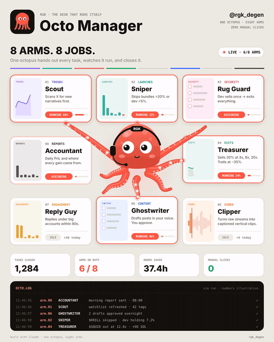

<div align="center">

# 🐙 RGK · Octo Manager

**One octopus. Eight arms. Eight jobs. Zero manual clicks.**



</div>

Octo Manager is a task desk run by one octopus. Every arm owns one job.
The octopus hands out each task, watches it run, and closes it. Nothing waits for a click.

This repo has two parts:

- **`index.html`**: the animated desk from the video. Open it in a browser and it plays live.
- **`octo/`**: a small Python version of the same idea. One queue, eight async arms, one log.

> Sim run. Every number on screen and in the log is illustrative. This is not financial advice.

## The eight arms

| Arm | Job | What it does |
|---|---|---|
| 01 · **Scout** | Trends | Scans X for new narratives first |
| 02 · **Sniper** | Launches | Skips bundles over 20% or dev over 5%, sizes the rest |
| 03 · **Rug Guard** | Security | If the dev sells once, it exits everything |
| 04 · **Treasurer** | Exits | Sells 20% at 3x, 8x, 20x, 50x, 100x and trails at −35% |
| 05 · **Clipper** | Video | Turns raw streams into captioned vertical clips |
| 06 · **Ghostwriter** | Content | Drafts posts in your voice for you to approve |
| 07 · **Reply Guy** | Engagement | Replies under big accounts within 90s |
| 08 · **Accountant** | Reports | Daily PnL and where every gain came from |

## The two lines worth stealing

```python
if tok.bundle_pct > 0.20: return   # bundled wallets hold too much
if tok.dev_hold   > 0.05: return   # dev holds too much
```

Everything that survives gets Kelly sizing, capped at 16 units, with a max bag of 12.
Then the Treasurer ladders out. The rules live in [`octo/arms.py`](octo/arms.py) and are covered by tests.

## Run it

**The animation:** open `index.html` in any browser. No build and no dependencies.

**The desk in your terminal** (Python 3.10+, standard library only):

```bash
python -m octo --seconds 20 --rate 3
```

```
OCTO.LOG  one octopus · eight arms · sim run, numbers illustrative

12:36:16  arm.02  SNIPER       $SQUID skipped · bundle 27%                    ✓
12:36:17  arm.02  SNIPER       $KRAKEN skipped · dev holding 9.8%             ✓
12:36:17  arm.01  SCOUT        narrative "zero click" +283% mentions          ✓
12:36:18  arm.04  TREASURER    $FROGGO sold 20% at 3x                         ✓
12:36:18  arm.02  SNIPER       $FROGGO sized 4/16 · entry                     ✓
12:36:20  arm.04  TREASURER    $SQUID sold 20% at 3x, 8x                      ✓
...
TASKS CLOSED 41   HOURS SAVED 24.6h   MANUAL CLICKS 0
```

**Tests:**

```bash
pip install pytest && pytest -q
```

**Export the video** (needs ffmpeg):

```bash
pip install playwright && playwright install chromium
python render.py video assets/demo.mp4   # 18s, 1080×1350, 30fps
```

## How it works

```
             ┌─────────── task queue ───────────┐
 feed ──▶    │  trend · launch · exits · clip … │
             └──────────────┬───────────────────┘
                            ▼
                      🐙 Octopus  ── routes by task kind, max 8 jobs on duty
        ┌────┬────┬────┬────┼────┬────┬────┬────┐
       01   02   03   04   05   06   07   08     one arm = one job at a time
        └────┴────┴────┴────┴────┴────┴────┴────┘
                            ▼
                        OCTO.LOG  ✓
```

- `octo/core.py`: `Task`, `Arm` and `Octopus`. Each arm holds a lock, so it only ever runs one job at a time.
- `octo/arms.py`: the eight arms, plus the filter, sizing and exit rules.
- `octo/sim.py`: the mock task feed.

To add your own arm, subclass `Arm`, set `number`, `name` and `kind`, implement `async work(task)` and add it to `all_arms()`.

## Files

```
index.html        animated desk (canvas, plays live)
render.py         deterministic frame exporter → MP4
octo/             python desk: core, arms, sim, CLI
tests/            rule tests
assets/           demo.mp4 · demo.gif · preview.png
```

---

<div align="center">
built with Claude · <a href="https://x.com/rgk_degen">@rgk_degen</a>
</div>
